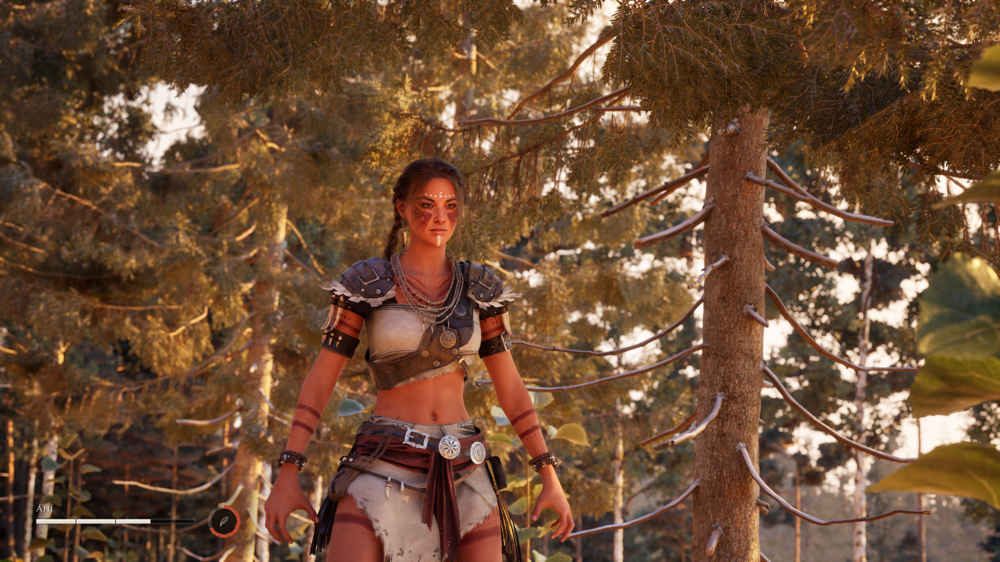

<p align="center">
  
</p>

<p align="center"><em>In-engine capture — Unreal Engine 5.8, golden hour.</em></p>

# Wildland — Studio & Workflow

**A professional, AAA-quality open-world game — built, engineered, and directed by one developer, with AI as a force multiplier.**


-1f6feb)


Wildland is a story-driven, third-person open-world action game — a real, professional
game-development project built and directed by **one developer**. The hands-on engineering is mine:
the C++, the Unreal Engine work, the Blueprints, the tools, the build pipeline, and the
infrastructure. AI is the **force multiplier** I use to move faster and cover more ground — but
**every architectural, technical, and creative decision is made and owned by me**.

This repository isn't the game. It's the **workflow** — how a single developer builds an open-world
title at a AAA quality bar by pairing hands-on engine and systems work with a disciplined, gated,
AI-assisted production pipeline. The game's design, assets, and source live in a private depot; what's
public here is the *method*.

---

## What I actually do here

I'm the director, architect, and sole authority on this project. Concretely, hands-on, every day:

- **Architect the systems** — I decide *where* every system lives before *how* it works: the C++
  character core, the athletic locomotion layer, the transformation state machine, world streaming,
  the camera, the frame budget. Architecture before implementation, always.
- **Read and own the C++** — I'm comfortable in the codebase and go into the code whenever it matters:
  reviewing diffs, tracing bugs through the character, hawk-transform and HUD systems, and checking
  that what the agents wrote is what I actually decided.
- **Drive the engine directly** — I operate Unreal Engine 5.8 day to day and build its pipelines: the
  C++/Blueprint split, Nanite and foliage pipelines, material graphs, lighting and atmosphere, World
  Partition, capture, and Perforce for all binary assets.
- **Build and wire the pipeline** — the multi-agent studio, the build/verify gates, the measurement
  tooling, the model-routing policy, and the automation that lets production run unattended are things
  I designed and maintain.
- **Own every visual and technical call** — nothing ships on look, feel, or performance without my
  explicit sign-off. Agents propose; I decide. Silence is never approval.
- **Integrate the tools** — the DCC side as well as the engine: Blender for mesh, fitting and
  retopo work, Marvelous Designer for clothing, MetaHuman, engine plugins, and the capture and QA
  scripts that connect them. The AAA look comes from *art direction → lighting → integration*, and I own that seam.

The AI studio is a force multiplier, not a replacement for judgment. It handles the volume; I hold
the bar.

---

## The core idea: a one-person studio that behaves like a real one

A real studio has specialists, a review pipeline, and gates that stop bad work from shipping. I
rebuilt that as a set of wired agents, each with a narrow job and a hard rule it can't cross:

| Role | Job | Gate it enforces |
|------|-----|------------------|
| **Feasibility Scout** | Research-first — find the wall in 30 minutes, not after 4 hours | Nothing hard starts unproven |
| **Build/Verify Runner** | The objective referee — compiles, runs tests, measures perf | "It should work" is never accepted; only real tool output |
| **Art Adversary** | Red-teams every visual against the AAA reference bar | No render reaches me ungated |
| **Taste Curator** | Keeps the work on *the game I actually want*, not just "good" | Quality ≠ correct direction |
| **Pipeline Medic** | Owns every tool/import/version error, ledger-first | Errors never derail the main session |

Each is adversarial *by design*. The point isn't to get an agreeable answer fast — it's to make bad
work fail loudly before it costs anything.

---

## The workflow

**Plan → Build → Verify → Review → Commit.** Never skip a stage.

```
        ┌─────────┐     ┌────────┐     ┌──────────┐     ┌─────────┐     ┌─────────┐
        │  PLAN   │ ──▶ │ BUILD  │ ──▶ │  VERIFY  │ ──▶ │ REVIEW  │ ──▶ │ COMMIT  │
        │ architect     │ small  │     │ compile/ │     │ adversar-     │ atomic, │
        │ first   │     │ diffs  │     │ measure  │     │ ial pass │     │ with why│
        └─────────┘     └────────┘     └────┬─────┘     └────┬────┘     └─────────┘
                                            │                │
                                     fails? └──── fix the ───┘
                                            foundation, don't stack on it
```

Two principles do the heavy lifting:

- **The oracle principle.** AI builds the game with minimal human clicking *to exactly the extent
  that I can build graders.* Every hour spent building an oracle buys back ten hours of unattended
  agent work. Gated work (compiles? tests pass? within budget?) runs free; load-bearing systems
  propose *through* the gate, never as a one-shot.
- **Measure, don't look.** Geometry questions get **numbers**, never pixels. *Is it floating,
  clipping, seated, the right scale?* is a measurement, answered with mesh tooling before any
  screenshot is taken. Taste questions — *does it look right?* — are the only ones that reach a
  human eye, because that's the only place human judgment is irreducible.

Full detail: **[docs/workflow.md](docs/workflow.md)** · **[docs/principles.md](docs/principles.md)**

---

## Engineering standards (non-negotiable)

- **Build it once, build it right.** Speed comes from not redoing work, never from cutting corners.
- **Foundation-first.** Lowest layers first, hardened under stress before anything stacks on them.
  A stage is done when it's smooth and glitch-free *under load*, not when it "works once."
- **Data-driven.** Tunable values live in config, never hardcoded in logic.
- **Separation of concerns; single source of truth for state; composition over inheritance.**
- **No magic numbers, no god classes, no copy-paste, no dead code.**
- **Fail loud in dev, safe in ship.** Never silently swallow an error.
- **`main` always builds.** Broken code never lands.
- **Readable over clever.** Comment the *why*, not the *what*.

---

## Tech stack

- **Engine:** Unreal Engine 5.8
- **Code:** hybrid — C++ for the core and anything performance-sensitive; Blueprints for gameplay,
  UI, and fast iteration
- **Characters:** MetaHuman base with a fully custom outfit/gear pass
- **World:** Nanite geometry, scanned foliage and material libraries, custom terrain, dynamic
  lighting and atmosphere
- **Capture/QA:** Movie Render Graph with an automated render-validity gate
- **Version control:** Git for the design/workflow layer, Perforce for all binary game assets
- **Automation:** a multi-agent production pipeline with build-gated verification and adversarial
  visual review

---

## Infrastructure

Running a one-developer studio at a professional bar means the plumbing has to be real, not
improvised. A chunk of this project is the engineering *around* the game — the version control,
servers, and multi-machine setup that a studio would normally have a whole IT/ops team for.

- **Perforce (Helix Core) as the asset backbone.** Every binary asset — meshes, textures,
  animations, audio, and the Unreal project itself — lives in a Perforce depot, the same
  version-control system AAA studios use for the large binary content that Git handles poorly.
  Atomic submits, file locking, and full history on multi-gigabyte assets.
- **Cloud-hosting the depot on Azure (in progress).** I'm standing up the Perforce server on
  **Microsoft Azure** so the depot is cloud-backed and reachable from anywhere instead of being
  pinned to a single box on my desk — the goal is proper remote access, resilience, and a clean path
  to off-site backup, the way a distributed studio actually operates.
- **Multi-machine workflow.** The project is built across several computers with non-overlapping
  jobs — a **macOS** machine for architecture, research, and pipeline strategy, and a **Windows**
  desktop for Unreal, C++, and asset production — each syncing to and submitting against the same
  Perforce depot. I can sit down at any machine, sync the latest, and keep building; nothing
  important lives in only one place.
- **Git as the wire between machines.** Decisions and build-state flow between the strategy and
  build machines through Git (append-only, one writer per file), which keeps the two sides
  coordinated and conflict-free while Perforce carries the heavy binary assets.

---

## Quality doctrine

The reference bar is fixed: **RDR2, GTA V, and Horizon Forbidden West.** Every asset is judged
*side-by-side with a real reference screenshot from those games* — never in isolation, because the
eye is great at comparison and terrible at recall. That single habit is what kills quality drift:
you never compare today's work to yesterday's, only to the bar.

RDR2 and Horizon were made with zero AI. That's the point — the tooling changed, the standard didn't.

---

## Status

**In production.** Milestone 1, *"First Playable"* — a great-looking third-person character, beautiful
open-world roaming, and a signature traversal mechanic, smooth and glitch-free — is the current
target. Foundation systems (character core, athletic locomotion, world environment) are built and
being hardened.

---

*Directed, architected, and built by [@timivashinko88](https://github.com/timivashinko88).*
